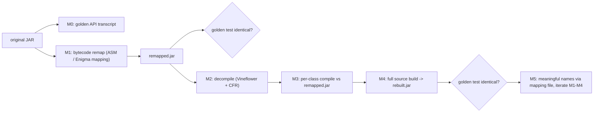

# Reconstruction Plan: course correction (2026-11-15)

> **Audience:** the agent continuing this project (Qwen).
> **Read this before you touch `java_source/com/solvitaire/solitaire/` again.**
> It replaces "Deeper next step #1" in `PROJECT_STATUS.md`.

## TL;DR

Stop hand-fixing `java_source/com/solvitaire/solitaire/`. That tree came from a
**textual** find-and-replace rename on top of CFR output. The rename corrupted
identifiers and string literals, and moving classes into packages added
hundreds of visibility errors. Raw CFR output also has unfixable obfuscation
artifacts, so the error count will not reach zero by "make it public / stub it"
fixes. The four identical "~120 errors fixed" commits show the loop is not
making progress.

Do this instead:

**Remap the bytecode first, then decompile, then compile and compare against a golden test.**

## Evidence (each check below was reproduced on 2026-11-15)

| # | Finding | How to reproduce | Consequence |
|---|---------|------------------|-------------|
| 1 | The obfuscator uses **class names that differ only by case**: `qo`/`qO`, `g`/`G`, `e`/`E`, `do`/`dO`. On Windows (case-insensitive FS), CFR renamed 494 of them to `*_0`. | `jar tf solvitaire_game_from_pe.jar \| findstr /R "app/qo app/qO app/g\.class app/G\.class"` | Raw CFR source can't map 1:1 onto the original classes. You can't recompile one class against the original JAR. |
| 2 | The obfuscator uses **Java keywords as class names** (`do`). | same listing | This is legal in bytecode and illegal in source. `do_0` was a symptom fix. |
| 3 | The obfuscator uses **same-name fields with different types** in one class. The engine `qo` has 2× `a`, 2× `b`, … 2× `h`. | `javap -p -cp C:/sgame/solvitaire_game_from_pe.jar com.solvitaire.app.qo` | This is legal in bytecode and illegal in Java. It is the real cause of the "invalid method signatures / AboutDialog overloads / type confusion" category in `docs/CFR_ARTIFACTS.md`. No access-modifier change can fix it. |
| 4 | The class rename `a → AboutDialog` was a **global text replace**. It hit every field, method, local and **string literal** named `a`. The refactored tree has 4,668 `AboutDialog` tokens. 175 lines have changed string literals, e.g. `"Cannot add AboutDialog run to AboutDialog stackset"` in `engine/CardStack.java` and `"Load and deal AboutDialog card file"` in the API help text. The same thing happened to `x → xHandler`, `u → uPanel`, `F → FPanel`, `C → CHandler`. | `Select-String -Pattern '"[^"]*\bAboutDialog\b' java_source\com\solvitaire\solitaire\*\*.java` | The refactored tree no longer matches the shipped program's behavior, even where it compiles. |
| 5 | The JNI class was moved to `com.solvitaire.solitaire.jni.WinUser32`. The DLL exports `Java_com_solvitaire_app_WinUser32_*`. | `strings C:\sgame\com_solvitaire_app_winuser32.dll \| findstr Java_` | The rebuilt game would hit `UnsatisfiedLinkError`. **`WinUser32` must stay `com.solvitaire.app.WinUser32`** with its native method names unchanged. |
| 6 | `Main.java` comments out the API thread, `ApiCommandProcessor`/`DesktopDuplication` are excluded from the build, and `GameStats` methods were stubbed. | `Select-String ApiCommandProcessor java_source\com\solvitaire\solitaire\Main.java` | Even a clean compile would drop API mode, which is the project's only verification path. Stubbing is not reconstruction. |
| 7 | Raw CFR output (`com.solvitaire.app`, 1,008 files) gives **353 errors, all parse errors**, in about 15 files (`CommandLine` 103, `co_0` 88, `g_0` 36, `qs_0` 26, `qt` 20, `e_0` 17, `pF` 13, `qr` 11, `pX` 10, …). | `javac -proc:none -Xmaxerrs 100000 -cp C:/sgame/solvitaire_game_from_pe.jar -d out @files.txt` | javac stops before attribution when it finds parse errors, so the **true** semantic error count is unknown. Per-file error counts in the docs are not reliable either. |
| 8 | Several docs said `Main-Class: com.solvitaire.solitaire.Main`. The manifest says `Main-Class: com.solvitaire.app.Main`. *(Docs corrected on 2026-11-15.)* | `jar xf <jar> META-INF/MANIFEST.MF` | Treat `com.solvitaire.app.*` as ground truth. |

## The correct pipeline

### M0: Golden test harness (do this first)

- Write `tools/golden_api_test.py` and run it through `uv run`. It should start
  `C:/sgame/javaw.exe -Djava.library.path=C:/sgame -jar <JAR> api` with
  `subprocess` (no PowerShell, because PowerShell mangles `-D`). It feeds the
  verified script `1^mode play`, `1^version klondike 1`, `1^difficulty easy`,
  `1^deal`, `1^status`, `1^solve`, `1^wait`, `1^list`, `1^step 3`, `1^status`,
  `1^exit`, then captures stdout.
- Take the JAR path as an argument. Save the shipped JAR's output as
  `tests/golden/klondike_1_easy.txt`.
- Run the shipped JAR twice to confirm the output is deterministic. If it
  isn't, normalize the nondeterministic parts (timestamps) and write down what
  you normalized.
- Add 1–2 more scripts, for example a Spider deal and `1^tracelevel`, to widen
  coverage.
- **Done when:** `golden_api_test.py C:/sgame/solvitaire_game_from_pe.jar` passes against itself.

### M1: Bytecode-level remap (removes the obfuscation artifacts at the source)

- Write a small remapper with ASM `ClassRemapper` + `SimpleRemapper`. Add the
  ASM jars to Gradle as a separate configuration, since Maven Central already
  resolves. Enigma, Recaf or SpecialSource are fine alternatives. Have it
  produce `remapped.jar` with:
  - **Classes:** case-insensitively unique, non-keyword names, e.g. `qo → C_qo`
    and `qO → C_qO2`, or the meaningful names from the AGENTS.md table where
    known. Keep the package `com.solvitaire.app` for now.
  - **Fields:** unique per class, e.g. `a:I → f_a_I`, `a:Lqv; → f_a_qv`. This
    removes finding #3.
  - **Methods:** rename only methods that are not overrides or implementations
    of JDK/XChart methods (`run`, `actionPerformed`, `paintComponent`,
    `compareTo`, …). Use a class hierarchy walk to detect those. Give
    overloads that differ only by return type distinct names.
  - **Never rename:** `com.solvitaire.app.WinUser32` or its `native` methods,
    `Main.main`, anything named in string-based reflection (grep the constant
    pool for `Class.forName`/`getMethod`), and the bundled `org.knowm.xchart.*`
    and other library packages.
- Write the mapping to `mappings/solvitaire.mapping` (one line per
  class/field/method). That file is the single source of truth for names from
  now on.
- **Done when:** `golden_api_test.py remapped.jar` gives output identical to the golden file. That proves the remap kept behavior intact before any decompiler is involved.

### M2: Decompile the remapped JAR

- Use **Vineflower** (`org.vineflower:vineflower` on Maven Central, an
  actively maintained Fernflower fork that usually gives more compilable output
  on obfuscated code than CFR) as the main decompiler. Keep CFR 0.152 for a
  second opinion. If you want a third, Procyon is on Maven Central
  (`org.bitbucket.mstrobel:procyon-*`) and GitHub releases. Only the Bitbucket
  download page was broken.
- Decompile only the app classes, not bundled XChart. Use XChart 3.8.1 from
  Maven as a dependency.
- Output to `java_source_v2/vineflower/` and `java_source_v2/cfr/`. **Don't
  overwrite `java_source/`.**

### M3: Per-class compile against `remapped.jar`

- For each class, compile **only that source file** with
  `-cp remapped.jar;xchart-3.8.1.jar`. Every other class then resolves from
  real bytecode, so each error belongs to that one file. This also gets around
  javac stopping at parse errors (finding #7).
- Script it so it writes `reports/compile_matrix.csv` with columns
  class, vineflower errors, cfr errors, chosen source.
- For each class, pick whichever decompiler's output compiles. Hand-fix only
  the remainder, using `javap -c -p` of the remapped class as the reference.
- **Stubbing a method body is not allowed.** If a method can't be decompiled
  yet, put the class on a "still from bytecode" list and move on.
- **Done when:** the matrix covers every app class, and each class either compiles or is on the "still from bytecode" list with a reason.

### M4: Full source build

- Point Gradle at `java_source_v2/merged/` (the chosen per-class sources).
  Patch-module or overlay is not needed once every class compiles. Build
  `rebuilt.jar` with the same manifest `Main-Class`.
- **Done when:** `gradle compile-java` has 0 errors, `golden_api_test.py rebuilt.jar` matches the golden output, and the native DLL loads.
- Only then turn on Checkstyle. Leave Spotless off (JDK 25 incompatibility, see
  AGENTS.md).

### M5: Meaningful names, done safely

- Give things readable names (SolitaireGameEngine, CardStack, …) by editing
  `mappings/solvitaire.mapping` and re-running M1 → M4. The other option is an
  AST-aware refactor (IntelliJ rename, OpenRewrite, or Spoon/JavaParser with a
  symbol solver).
- **Never use text replace.** Rerun the golden test after every batch of renames.
- Split into packages (`engine`, `solver`, `ui`, …) last, if at all.
  Package-private access between classes was valid in the original single
  package. Splitting is what forced the ~165 `public` edits.

## What to do with the existing `com.solvitaire.solitaire` tree

- **Freeze it** and stop editing it. Mark it as legacy in `build.gradle.kts`
  once `java_source_v2` builds.
- Use it only as a source of **names**. Its class-rename table (`qo →
  SolitaireGameEngine`, `qv → CardStack`, …) seeds the class section of the
  mapping file.
- Remove the test skeletons' dependency on it. Rewrite the tests against
  `java_source_v2` once M4 passes.

## Process rules

- One milestone per session. Update `PROJECT_STATUS.md` with numbers that come
  from a command you actually ran, and paste the command.
- Commit messages must describe what changed. Don't repeat the same message
  ("~120 errors fixed" appears 4 times in `git log`).
- Don't write "Goals complete" or "Project is complete" while M4 isn't passing.
- Use the REA skill when a claim depends on the binary (installer, launcher, or
  DLL). The Java remap/decompile/compile loop is ordinary JVM tooling. REA's
  MCP 30 s timeout makes it a poor fit there anyway.
